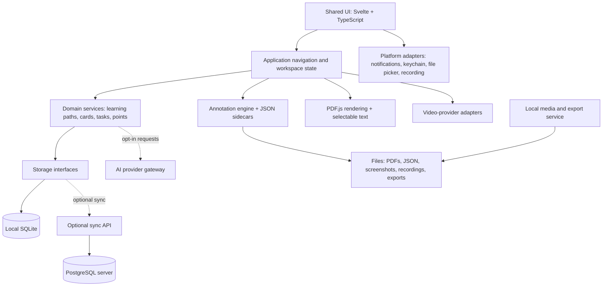
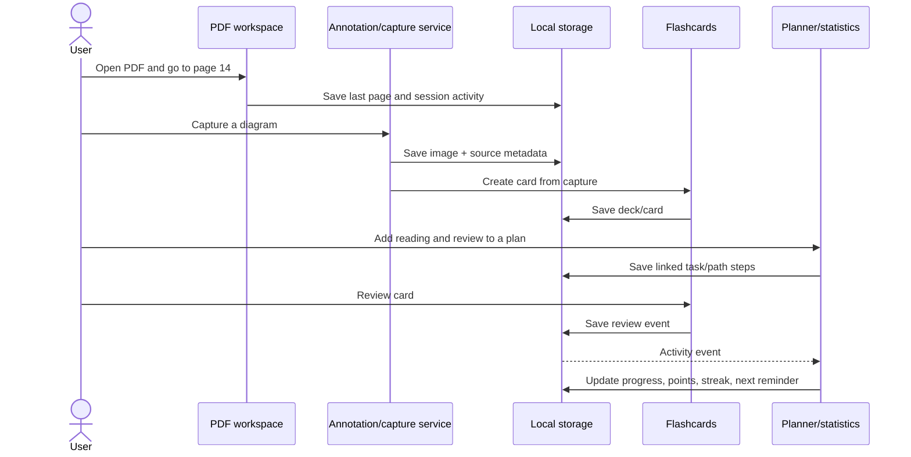

# Study Productivity App — Product, UI, and Technical Architecture Plan

> **Document status:** Initial implementation blueprint  
> **Working title:** StudyOS (placeholder; choose a final name later)  
> **Primary objective:** Help a person turn PDFs, videos, and flashcards into a connected, measurable learning routine.  
> **Initial target:** Windows, macOS, and Linux desktop; architected for Android, iOS, and browser use.  
> **Guiding principle:** A small, offline-capable learning workspace—not a collection of unrelated tools.

---

## 1. Product vision

Build an open-source desktop-first learning and productivity application that brings together:

- A PDF reader with a remembered library, history, annotations, screenshots, and export tools.
- An in-app learning video workspace for supported providers, with timestamps, repeat ranges, screenshots, and notes.
- A simple image-first flashcard system with difficulty ratings and spaced repetition.
- A planner, calendar, repeatable study schedule, task checklist, and reminders.
- Learning paths that connect materials and activities in a deliberate sequence.
- Optional AI features for summarizing, explaining, extracting key ideas, and generating cards.
- Lightweight statistics, streaks, points, goals, and optional gamification.
- A screen-capture/recording tool for making teaching material, subject to operating-system and provider restrictions.

### The product's central workflow

A user should be able to create one plan such as:

1. Read pages 10–20 of `Biology.pdf`.
2. Save three important image regions from page 14.
3. Watch a YouTube lesson from 03:20 to 18:00.
4. Review the flashcards generated from the screenshots and video notes.
5. Mark the task complete and see progress in the calendar and statistics.

The relationships must be real data relationships, not just links pasted into notes. A PDF page, screenshot, annotation, video timestamp, flashcard, task, learning path, and study session should be able to refer to one another.

### Non-goals for the first release

Do **not** try to ship every feature at the same time. The first version should not attempt to become a complete PDF editor, a replacement for YouTube/Vimeo, a social network, a full LMS, a cloud-storage provider, or an advanced video-editing studio. It should focus on reading, annotating, capturing, reviewing, planning, and tracking.

---

## 2. Product principles

1. **Local-first and private by default.** Reading, annotations, screenshots, cards, tasks, and statistics must work without an account or internet connection wherever technically possible.
2. **Small installation.** Use the operating system's WebView instead of bundling a separate browser runtime. Keep heavy engines and AI dependencies optional where practical.
3. **Fast to use.** Common actions should take one click or one shortcut. Keep the user-facing annotation toolbox to a short set of predictable tools.
4. **Source-safe.** Never silently modify the user's original PDF or video. Save annotations as separate data and make exporting a copy explicit.
5. **Arabic and English from the beginning.** Support RTL and LTR text, Arabic shaping, mixed-direction text, keyboard navigation, and language-aware layouts.
6. **Accessible.** Keyboard and touch input should both work; use visible focus, scalable UI, and adequate contrast.
7. **Composable features.** The user can study with only PDFs or only cards; the other tools should add value without being required.
8. **Open formats.** Use JSON for annotation sidecars, ordinary image files for captures, portable exports, and documented database schemas.
9. **Honest progress.** Reward deliberate activity rather than simply leaving a file or video open.
10. **No surprise AI uploads.** Explain what content will be sent to a provider before sending it.

---

## 3. Recommended technology decisions

### 3.1 Suggested stack

| Layer | Recommendation | Why |
|---|---|---|
| Desktop shell | **Tauri 2** | Rust backend + system WebView; a good match for a small cross-platform desktop app. Tauri's architecture documentation explains that it uses the system WebView rather than shipping a separate browser runtime. |
| UI | **TypeScript + Svelte + Vite** | A compact reactive UI with a good fit for toolbars, panels, touch layouts, and a browser build. React is also viable if contributors prefer it; do not build a custom UI framework. |
| PDF rendering | **Mozilla PDF.js** | Renders PDFs in the same UI layer used by desktop, mobile WebViews, and browsers. |
| Annotation drawing | Custom TypeScript/SVG or Canvas overlay | Keep the visible annotation model and JSON format under project control. PDF.js is a renderer, not a complete annotation editor; its own FAQ distinguishes rendering annotations from authoring/editing them. |
| Native services | Rust modules behind a platform adapter | File operations, secure settings, database access, export, notifications, and OS integration. |
| Local database | **SQLite** | Zero-server local persistence for document history, cards, tasks, sessions, and statistics. |
| Annotation files | Versioned JSON sidecars | Human-inspectable, portable data per source PDF. |
| Optional sync/server database | **PostgreSQL** | User accounts, synchronization, encrypted backup metadata, multi-device data, and optional hosted features. Do not require a PostgreSQL server merely to open a PDF. |
| Video providers | Provider adapter; official embed/player SDK first | Supported embedded players can report playback state and duration, but controls and metadata vary by provider. |
| AI | Provider interface with optional adapters | Gemini, OpenAI-compatible APIs, and other providers can be added without coupling the app to one service. |
| Testing | Rust tests + UI/component tests + Playwright where supported | Validate annotation geometry, persistence, PDF workflows, keyboard/touch, exports, and platform adapters. |

Reference documentation:

- [Tauri architecture](https://v2.tauri.app/concept/architecture/)
- [PDF.js project](https://github.com/mozilla/pdf.js/)
- [PDF.js API](https://mozilla.github.io/pdf.js/api/draft/module-pdfjsLib-PDFDocumentProxy.html)
- [Rust PDFium bindings](https://docs.rs/pdfium-render/latest/pdfium_render/) for a later optional native PDF extraction/export engine
- [SQLite architecture](https://www.sqlite.org/arch.html)
- [SQLx database drivers](https://docs.rs/sqlx/latest/sqlx/) for a server implementation that uses PostgreSQL

### 3.2 Important architecture choice: SQLite locally, PostgreSQL for sync

PostgreSQL is an excellent server database, but it is a client/server service: ordinary desktop users would otherwise need to install, start, secure, back up, and maintain a database server merely to use a study tool. That conflicts with the goal of a small, simple, offline program.

**Recommended default:**

- **Desktop/mobile offline mode:** SQLite database in the app's private data directory; annotation files and media remain ordinary files.
- **Web mode:** IndexedDB/OPFS for local browser data where available.
- **Optional account/sync service:** Rust API + PostgreSQL on a server.
- **Optional self-hosted mode:** allow advanced users to run the sync service against their own PostgreSQL instance.

Use a repository/service abstraction so features do not depend directly on SQLite or PostgreSQL queries. The local app must remain fully useful without a server. If PostgreSQL is a hard requirement for every installation, it will increase setup complexity and should be documented as an advanced deployment profile rather than the default.

### 3.3 Keep the web version realistic

Share the UI and domain types, but do not pretend browser storage and native file access are identical:

- Desktop uses native file pickers, local paths, OS keychain, native notifications, and platform screen capture.
- Mobile uses native file providers, app-private storage, platform notifications, and native capture APIs where supported.
- Web uses browser file pickers, IndexedDB/OPFS, browser permissions, and a server for cross-device sync/push.

Native recording, reliable reminders while the app is closed, and arbitrary local-file access need separate platform adapters. Keep those services out of the shared reading/card business logic.

---

## 4. High-level architecture



### 4.1 Main modules

Organize the application around independent modules with documented interfaces:

- `app-shell`: windows, routing, global shortcuts, navigation, themes, localization.
- `library`: PDF/video/deck list, search, recent history, folders, tags, import/relink.
- `pdf-workspace`: PDF.js render lifecycle, page navigation, zoom, text selection, bookmarks.
- `annotation-engine`: drawing tools, geometry mapping, selection, erasing, layers, undo/redo, JSON serialization.
- `capture-gallery`: region screenshots, thumbnails, naming, file organization, export queue.
- `video-workspace`: provider detection, embed SDKs, timestamps, loop segments, study progress.
- `flashcards`: image cards, text cards, difficulty rating, review scheduling, import/export.
- `planner`: calendar, study blocks, task checklist, reminders, goals, recurring plans.
- `learning-paths`: ordered and conditional activities spanning PDF pages, videos, cards, and tasks.
- `gamification`: configurable point rules, streaks, badges, level history, daily goals.
- `statistics`: event aggregation and visual reports.
- `ai`: provider settings, consent, prompt templates, summarization, card generation.
- `recorder`: native capture backends and post-processing; optional feature.
- `storage`: SQLite/browser storage, JSON sidecars, file paths, import/export, sync adapter.
- `sync` (optional): identity, device registry, conflict resolution, encrypted transport and backup.

### 4.2 Architectural boundaries

- UI components should not write arbitrary SQL.
- PDF.js rendering should not own task, points, or flashcard rules.
- An annotation's coordinates should not be saved in screen pixels.
- AI output should be treated as an editable suggestion, not trusted automatically.
- File paths should go through a storage service and a permission-aware file picker.
- Notifications should be scheduled through a platform adapter, not by UI timers.
- Providers and optional modules should fail gracefully without making the core application fail to open.

---

## 5. Main navigation and global UI

### 5.1 Desktop layout

Use a slim left navigation rail and a main workspace. Keep the app visually quiet: neutral background, subtle dividers, one accent color, and limited card borders.

```text
┌──────────────────────────────────────────────────────────────────────────┐
│ StudyOS  [Search materials, pages, cards, tasks...]        [●] [Settings]│
├────────────┬─────────────────────────────────────────────────────────────┤
│ Today      │ Workspace / active screen                                  │
│ Library    │                                                             │
│ Learning   │                                                             │
│ Videos     │                                                             │
│ Flashcards │                                                             │
│ Planner    │                                                             │
│ Statistics │                                                             │
│ Screenshots│                                                             │
│ Settings   │                                                             │
└────────────┴─────────────────────────────────────────────────────────────┘
```

The sidebar should collapse to icons. Remember its state. Do not put every tool at the top-level navigation; keep contextual actions in the current workspace.

### 5.2 Global search

Search across:

- PDF filenames and metadata.
- User-created annotation text and optional extracted PDF text index.
- Screenshot names, captions, and source pages.
- Video titles, user notes, and timestamps.
- Flashcards, deck names, tasks, and learning paths.

Results should show context, such as `Biology.pdf · page 14` or `Cell division video · 08:24`, and open directly at that location.

### 5.3 Shared visual language

- Light and dark themes.
- Compact, comfortable, and touch-oriented density modes.
- One clear accent color for active state; annotation colors remain separate.
- Arabic/English language setting and correct RTL/LTR direction.
- Tooltips on desktop; labels or accessible names for all icon buttons.
- Confirmation only for destructive operations; autosave should not interrupt the user.
- Always display a subtle saved/saving/error indicator for files that are being edited.

---

## 6. Screen designs

### 6.1 Today dashboard

Purpose: help the user decide what to do next without becoming a wall of statistics.

```text
┌ Today ───────────────────────────────────────────────────────────────────┐
│ Good morning                                                             │
│ [Start focus session] [Continue last item]                               │
│                                                                          │
│ TODAY'S PLAN                    QUICK CONTINUE                           │
│ □ Biology: pages 10–20          Biology.pdf · page 14                    │
│ □ Watch lesson 03:20–18:00      Cell division video · 08:24              │
│ □ Review 18 due cards           [Continue]                               │
│                                                                          │
│ WEEKLY GOAL  ███████░░░  4.5 / 6 hours     Streak 5 days                 │
│                                                                          │
│ Recent material       Due cards       Upcoming reminders                 │
└──────────────────────────────────────────────────────────────────────────┘
```

Rules:
- Show no more than three to five top priorities initially.
- Prioritize due/recent learning tasks, not vanity metrics.
- Allow the user to hide widgets and reorder them.
- “Continue” resumes last position in a PDF, video, or review session.

### 6.2 Library

A searchable list/grid of PDFs, videos, decks, screenshots, and learning paths. Each resource row/card includes title, type, last opened, progress, tags, and a context menu. Include filters for `PDF`, `Video`, `Deck`, `Learning path`, and `Screenshots`.

PDF history must remember the last page, zoom, scroll position, and last-opened timestamp. If a file is moved or deleted, show “Locate file” rather than silently dropping its history. Allow clearing history separately from deleting a library record.

### 6.3 PDF workspace — primary screen

PDF tools must appear in **one horizontal row at the top of the page**, as requested. When width is too small, group low-frequency actions into an overflow menu while keeping the primary tools accessible.

```text
┌ Biology.pdf  ‹ 14 / 220 ›  [−] 100% [+] [Fit] [Search] [⋯] ─────────────┐
│ Select  Text  Marker ▾  Shape ▾  Red pen  Hand  Eraser  Undo  Redo       │
│ [Yellow][Orange][Red][Green][Blue][Purple][Grey]  Opacity ──●  Size ─●  │
├─────────────────────────────────────────────────────────────────────────┤
│ Page thumbnails (optional) │ PDF page canvas                            │
│                             │                                            │
│ [13] [14] [15]              │             rendered PDF + overlay        │
│                             │                                            │
│                             │                                            │
├─────────────────────────────────────────────────────────────────────────┤
│ Page 14 of 220 · Saved ✓ · [Annotations only] [Highlights only] [Grid]  │
└─────────────────────────────────────────────────────────────────────────┘
```

Key behaviors:

- Open a PDF using the native/browser file picker or drag-and-drop.
- Remember recent PDFs and restore the last reading position.
- Render pages incrementally; only render high-resolution pages as needed.
- Use a separate interactive annotation overlay above the PDF canvas.
- The user can toggle normal view, all annotations, annotations-only view, and highlights-only view.
- Annotations-only view can render on a blank or neutral page canvas with page outlines and labels, but must preserve each annotation's original page coordinates.
- Provide optional grid guides without altering the original PDF.
- Add bookmarks, page notes, and a minimal search panel; keep them outside the main annotation tool strip.
- Autosave after each completed interaction and display a saved indicator.
- The document remains unchanged until the user chooses an export/flatten operation.

### 6.4 Annotation toolbox and behavior

The main tool set should remain small. Advanced controls appear contextually after choosing a tool.

#### Text writer

- Place a text box on a page by clicking/tapping.
- Choose font family and size; use standard local fonts and allow system fonts.
- Choose text color, background/outline if needed, line spacing, alignment, and direction: `Auto`, `LTR`, or `RTL`.
- Correctly support Arabic shaping, punctuation, Arabic/Latin/numeric mixed text, and cursor movement in bidirectional text.
- Optional ruled-paper or grid background is an editing aid; it is not part of the exported page unless the user explicitly asks to include it.
- Text box supports resize/move; double-click/tap to edit; Escape exits editing.

#### Marker/highlighter

Palette: **yellow, orange, red, green, blue, purple, grey**.

Controls:
- Shape mode: horizontal, vertical, or cross.
- Thickness slider from a small pen line to a wide marker.
- Opacity slider.
- Color palette.
- Optional edge smoothing.

**Required pointer geometry:** the marker is centered on the pointer/finger, not offset from it. For a marker thickness of 40 logical screen units, the stroke extends approximately 20 units to either side of its centerline. On a touchscreen, use the actual contact point/centroid reported by the platform. The cursor preview must show the effective stroke width before drawing.

The saved geometry is expressed in PDF page coordinates, not screen pixels. This is essential so strokes remain attached to the same content after zoom, rotation, or window resizing.

#### Shapes

- Rectangle and ellipse/circle.
- Arrow and straight line.
- Green correct/check sign.
- Red cross/wrong sign.
- One-color style and two-color style (stroke/fill or outline/background).
- Color, opacity, and thickness controls similar to the marker.
- Drag from first point to second point; use handles to reposition/resize when selected.

#### Temporary red pen

- Red freehand pen intended for live explanation/teaching.
- All pen strokes made during a burst are one temporary overlay package.
- If no new stroke is drawn for **3 seconds**, fade/clear the package according to the user's chosen mode.
- Default mode should be temporary and not persisted. Offer an explicit “Keep as annotation” command for any stroke the user wants to save.
- Timer must reset on new input; implement it in the UI/controller layer, not as dozens of independent timers.

#### Pointer hand

- A hand/pointer tool for indicating a specific area without leaving permanent ink.
- Optional large cursor/ripple for screen recordings and presentations.
- Must not interfere with normal page scrolling or touch navigation.

#### Eraser

- Erases any annotation it touches based on geometric hit testing, not merely the annotation's center point.
- For freehand strokes, test distance to segments using the effective stroke width plus eraser radius.
- For shapes, test stroke/fill geometry and allow selection-based deletion for hard-to-hit objects.
- Support undo/redo for every erase operation.

#### Undo and redo

- Maintain command-based undo/redo per document during an editing session.
- Group a continuous drag into one command; text edits should become a single command when editing is committed, not every keystroke.
- Save the result immediately after an operation completes.
- After restart, persisted annotations must remain intact. The initial release does not need to preserve an unlimited undo history across restarts.

### 6.5 Screenshot capture and gallery

There are two distinct operations:

1. **Capture a screen region** using a drag rectangle and save it as an image.
2. **Capture a PDF page region** by selecting a rectangle in page coordinates and rendering that source region at a chosen resolution.

The second method should produce clean page content and be the default when studying a PDF; the first is useful for capturing the entire application during a lesson. The selection preview must display the exact bounds before saving.

After capture, show a small non-blocking panel:

- Thumbnail preview.
- Filename and destination.
- Source PDF/video and page/time where available.
- Optional title/caption/tags.
- `Save`, `Save + create flashcard`, and `Cancel`.

Gallery screen:

- List/grid view with thumbnails.
- Filter by source PDF, page range, date, tags, and “not yet added to a deck.”
- Sort by page, creation time, or name.
- Open a capture in a crop/markup view.
- Select multiple images and export them as a single PDF or create image-based cards.
- Display source information in a side panel rather than burning it into the image.

### 6.6 Video workspace

Video and flashcard primary controls should be on **one horizontal row at the bottom** of their workspace. On narrow screens, the row can horizontally scroll or collapse into a bottom sheet.

```text
┌ Cell Division — video page ──────────────────────────────────────────────┐
│ [Paste a video URL...] [Open]                                           │
│ Title · Provider · Duration · Last position                             │
│                                                                         │
│                    ┌──────────────────────────┐                         │
│                    │                          │                         │
│                    │       VIDEO PLAYER       │                         │
│                    │                          │                         │
│                    └──────────────────────────┘                         │
│ Notes and captured moments:  03:20  ·  08:24  ·  12:10                   │
├─────────────────────────────────────────────────────────────────────────┤
│ Play  −10s  +10s  Repeat A–B  Speed  Annotate  Screenshot  Fullscreen    │
└─────────────────────────────────────────────────────────────────────────┘
```

Features:
- Paste a supported URL and detect the provider.
- Display title, channel/owner when available, duration, thumbnail, and provider.
- Save last position and user notes.
- Repeat a specific segment with A/B markers.
- Use keyboard shortcuts for play/pause, seek, and setting repeat points.
- Record a screenshot linked to its video timestamp.
- Open the annotation workspace over a captured video frame: pause playback, capture the current frame if accessible, edit the image in the same workspace, and save it as an image/annotation. Resume only when the user explicitly chooses to.
- Use a customized player shell, not a fake replacement of the provider's protected player.

**Provider constraints:** YouTube and Vimeo expose different features and data. Use their official embedded player APIs/SDKs. Do not promise that branding, advertisements, related-video elements, or every provider control can be removed. YouTube's IFrame Player API exposes playback commands/events and video information; Vimeo's SDK exposes playback interaction and embed settings, but provider policies still apply. Some videos may not be embeddable or may hide metadata. When the API does not provide trustworthy duration, show “Duration unavailable” instead of guessing.

Reference: [YouTube IFrame Player API](https://developers.google.com/youtube/iframe_api_reference), [YouTube API Services Terms](https://developers.google.com/youtube/terms/api-services-terms-of-service), [Vimeo Player SDK](https://developer.vimeo.com/player/sdk).

### 6.7 Flashcard review screen

Use a focused, distraction-free card view. Avoid putting a large dashboard around the card.

```text
┌ Deck: Biology · Due 18 · Card 4 of 18 ───────────────────────────────────┐
│                                                                         │
│                       [ IMAGE / QUESTION ]                              │
│                                                                         │
│                      [Show answer]                                      │
│                                                                         │
│ After reveal:                                                           │
│ [Again]       [Hard]       [Good]       [Easy]                          │
│                                                                         │
├─────────────────────────────────────────────────────────────────────────┤
│ Undo · Edit · Bookmark · Suspend deck · End session                     │
└─────────────────────────────────────────────────────────────────────────┘
```

Card types:
- Image-only card, with optional front/back images.
- Text question/answer card.
- Image with optional short prompt or caption.
- Cloze/text card later, not necessary for the first version.

The user can select a screenshot and create a card quickly. The minimal flow is: choose an image → optionally add a short front/back description → save to a deck. Difficulty buttons should be easy to hit with a mouse or thumb.

Use a documented spaced-repetition algorithm. Keep the scheduler replaceable so the project can change algorithms without rewriting card UI. Store review history, not just the next due date. Include CSV/TSV export and an Anki-friendly export workflow for text/image cards; follow the media placement and UTF-8 requirements in the [Anki text import manual](https://docs.ankiweb.net/importing/text-files.html). Full `.apkg` compatibility should be a later milestone and should be validated with the official format/library ecosystem rather than improvised.

### 6.8 Planner and calendar

Views:
- Day agenda (default on mobile).
- Week grid (desktop default).
- Month overview.
- Task list / overdue items.

Task fields include title, description, estimated duration, due date, priority, recurrence, status, related resources, checklist, and reminder policy.

A study block may be as specific as “Biology.pdf, pages 10–20, every day 15:00–15:50.” One planned block can contain a sequence of actions: read pages, watch a timestamp range, then review a particular deck.

The UI should support drag-to-reschedule, but also a simple edit dialog. Recurring rules must make it clear whether changes apply to one occurrence or the whole series.

Notification rules:
- Ask for OS/browser permission only when the user first enables reminders.
- Provide snooze, complete, and open-task actions where the platform supports them.
- Persist planned reminders so they are not dependent only on an in-memory timer.
- Native reminders while the app is closed require OS scheduling/background integration; browser push generally needs a service worker and a backend. Explain those differences honestly by platform.

### 6.9 Learning path builder

The learning path is a lightweight sequence of linked activities, not an elaborate workflow editor.

```text
Cell Biology Path
  1. Read Biology.pdf — pages 10–20
  2. Save/examine 3 diagrams
  3. Watch video — 03:20 to 18:00
  4. Review deck — Cell Biology (18 cards)
  5. Complete self-check task
```

Each step references a resource and optional target (PDF page range, video time range, selected cards, or task checklist). A path tracks not started/in progress/completed, and resumes at the next incomplete step. Support reusable templates and duplicate paths.

### 6.10 Settings

Sections:

1. **Appearance:** theme, language, density, sidebar, default workspace.
2. **PDF and annotations:** default zoom, page layout, grid, autosave, font defaults, line opacity/thickness, marker defaults.
3. **Files and screenshots:** root folder, main-folder vs per-PDF folders, file naming template, image format/quality, duplicate handling.
4. **Video:** playback speed, default seek step, loop behavior, supported providers.
5. **Flashcards:** scheduler, daily new-card limit, point values, default deck, export settings.
6. **Planner and notifications:** timezone, quiet hours, default reminder time, week start, recurring plans.
7. **AI:** provider, model, endpoint, key management, privacy options, prompt templates, limits.
8. **Recording:** capture backend, frame rate, output format, audio/microphone choices, temporary folder, region/window/screen mode.
9. **Data and sync:** backup, import/export, local storage location, server URL, device list, sync status, delete-account/data controls.
10. **Advanced:** diagnostics, accessibility, keyboard shortcuts, experimental modules.

Never put a raw provider API key in a plain-text settings file. On desktop, use the OS credential store/keychain; on mobile, use platform secure storage; on web, use a server-side secret or short-lived in-memory entry rather than localStorage.

### 6.11 Statistics and gamification

The statistics screen should explain habits and outcomes, not just count clicks:
- Study time by day/week/month.
- Time by source/material and by activity type.
- Pages read, annotation count, captures saved, videos actively watched, cards reviewed, and tasks completed.
- Review accuracy and due-card backlog.
- Goal progress, active days, and streak history.
- Learning path completion.

Use small charts and labels. Avoid claiming that page count alone proves comprehension.

Gamification preferences:
- Default suggested points: one point for a qualifying page-read event, one point for a card review, one point per active video minute, and configurable points for completed tasks or study sessions.
- Let the user change each value or disable points entirely.
- Avoid awarding the same page every time a user rapidly scrolls across it. Define a qualifying event (e.g., page visible for a minimum dwell time or explicitly marked complete), but make the policy configurable.
- Count actual active playback progress where the provider API allows it, not just the declared length of a pasted video. Avoid rewarding repeated looping of the same segment by default.
- Streaks should follow the user's timezone and a configurable daily goal. Provide a grace-day option rather than shaming users for missing a day.
- Badges are optional, quiet, and can be disabled. No loot boxes, manipulative urgency, or pay-to-progress mechanics.

### 6.12 Recording studio

A separate compact screen/panel that records a selected region, window, or full display where the OS supports it. Allow microphone input, system audio when permitted, pointer highlighting, and temporary red-pen marks. Offer start, pause, resume, stop, preview, trim beginning/end, and export.

**Important feasibility limit:** capture APIs and permissions differ across Windows, macOS, Linux, Android, iOS, and browsers. Browser `getDisplayMedia()` requires a user interaction and permission each time; it does not grant silent permanent access. Apple provides platform screen-recording APIs, but their availability/behavior differs by target and protected media may not be capturable. Native desktop region selection should be implemented per OS. Mobile should initially support in-app content capture where allowed, then be evaluated separately for device-wide recording. Do not promise universal capture of DRM-protected video or arbitrary applications.

Reference: [Browser Screen Capture API](https://developer.mozilla.org/en-US/docs/Web/API/MediaDevices/getDisplayMedia), [Apple ReplayKit](https://developer.apple.com/documentation/replaykit), [Apple ScreenCaptureKit](https://developer.apple.com/documentation/ScreenCaptureKit).

---

## 7. Annotation engine — geometry and data model

### 7.1 Coordinate system

Every saved annotation uses a canonical coordinate system tied to a PDF page or captured image:

- Store points in normalized page coordinates from `0.0` to `1.0` where possible, with page width/height metadata and a documented origin.
- Convert pointer screen coordinates through the current canvas transform (scroll, zoom, device pixel ratio, rotation) into page coordinates before saving.
- Recompute screen geometry from page coordinates for every render.
- Store stroke width in a clearly documented logical/page unit model. Prefer a visual-width setting mapped predictably to rendered scale; do not reinterpret screen pixels as PDF points after a zoom change.
- Keep pointer location at the center of the marker stroke. Test horizontal, vertical, and cross modes at 50%, 100%, 200%, rotation, fit-to-width, and different DPI settings.

If using normalized page coordinates, preserve exact page aspect ratio and store the original page box/rotation information. When displaying annotation-only mode, use the same page transform so positions do not drift.

### 7.2 JSON sidecar strategy

Store one versioned JSON file per source PDF, separate from the original PDF. Example layout:

```text
StudyOSData/
  library.sqlite
  annotations/
    <document-id>.annotations.json
  screenshots/
    <document-id>/          # optional per-PDF organization
  recordings/
  exports/
  backups/
```

Default screenshot behavior:
- Default to the configured main screenshots folder so all captures are easy to find.
- Offer a setting for one folder per PDF.
- Use a sanitized base name plus stable source metadata and a unique suffix; never rely on the PDF filename alone because multiple documents can share it.
- Record each screenshot's original source and link in the local database as well as its own file path.

Example sidecar shape:

```json
{
  "schema_version": 1,
  "document_id": "c7d2c96f-5d1e-4c37-a98c-71a4ee8d1f00",
  "source_fingerprint": "sha256:optional-content-fingerprint",
  "updated_at": "2026-10-09T09:00:00Z",
  "page_metadata": {
    "14": { "width": 612, "height": 792, "rotation": 0 }
  },
  "annotations": [
    {
      "id": "a68e40f4-4f37-4e6c-ae90-07af8e19c123",
      "type": "marker",
      "page": 14,
      "geometry": {
        "mode": "horizontal",
        "points": [[0.18, 0.42], [0.78, 0.42]]
      },
      "style": {
        "color": "#F4D03F",
        "opacity": 0.55,
        "thickness": 0.012
      },
      "created_at": "2026-10-09T09:00:00Z",
      "updated_at": "2026-10-09T09:00:00Z",
      "tags": []
    }
  ]
}
```

This is an illustrative schema, not a final contract. Define schema validation and migration rules before release. Include an explicit document identity strategy, because paths can change and filenames are not unique. Compute content fingerprints in the background when needed; for very large files, do not block opening while hashing.

### 7.3 Safe persistence

- Write to a temporary file, flush, and atomically replace the existing JSON file where the platform permits.
- Debounce rapid changes but flush at the end of an operation, on document switch, and before app shutdown.
- Keep a small rolling backup of the previous sidecar version to recover from malformed JSON or interrupted writes.
- Validate loaded JSON and ignore unknown optional fields; refuse unknown incompatible major schema versions without destroying data.
- Keep annotation identifiers stable so screenshot/card/task links do not break when annotations are edited.
- Do not serialize temporary red-pen strokes unless the user promotes them to saved annotations.

### 7.4 Eraser hit testing

Hit testing must use the rendered geometry, including opacity-independent stroke bounds:

- Freehand path: calculate distance from the eraser center to each line segment and compare it with half the stroke width plus eraser radius.
- Marker: use its effective geometry and thickness.
- Line and arrow: distance-to-segment test.
- Rectangle/ellipse: test border and, if filled, interior.
- Text: hit the text box bounds; optionally select then delete.
- Check/cross: test the path bounds and allow selection fallback.

Make the eraser preview visible and scale it consistently. On touch screens, ensure the eraser can reach an object without the finger obscuring the whole object; consider an offset loupe/precision mode for small controls, but do not move the saved stroke off the finger position.

### 7.5 Export behavior

Offer distinct actions:

1. **Export annotated PDF:** generate a new PDF with chosen annotations flattened or represented as native PDF annotations if the selected engine can do so reliably.
2. **Export highlighted excerpts PDF:** one cropped excerpt per selected marker/highlight, with source filename and page number optionally included as a caption.
3. **Export screenshot gallery to PDF:** combine selected captures in a chosen order, optionally with source/page/timestamp labels.
4. **Export annotation JSON:** export the portable sidecar.
5. **Export images/cards:** export image files and a UTF-8 CSV/TSV mapping card front/back fields and media names.

Do not change the source PDF in place. Make limitations explicit if a PDF is encrypted, corrupt, uses unsupported features, or requires a password.

---

## 8. Storage model and core entities

### 8.1 Files versus database

Use files for large or naturally portable artifacts; use the local database for structured records and indexes.

**Files:** original PDFs (never duplicated unless imported/copy mode is selected), annotation JSON sidecars, screenshots, extracted image assets, recording videos, generated PDFs, AI summary exports.

**SQLite/local browser database:** library index, source metadata, last reading positions, video bookmarks, decks, cards, review history, tasks, learning paths, planned sessions, completed sessions, point ledger, settings that are not secrets, reminder metadata, sync queue.

**PostgreSQL/server:** accounts, devices, sync versions/tombstones, server-side preferences if needed, subscriptions only if the project ever adds them, and encrypted backup/sync metadata. Do not send original PDFs, captured images, or AI source text to the server unless the user explicitly enables that feature.

### 8.2 Core entities

- `Document`: id, source path/URI, title, content fingerprint, page count, last page, zoom, last opened, missing-file status.
- `AnnotationFile`: document id, path, schema version, update time, checksum.
- `Annotation`: defined in JSON; indexed summary includes id, page, type, text/search tokens, timestamps.
- `Capture`: id, file path, source type, source id, page/time, rectangle, tags, caption, created time.
- `VideoResource`: id, provider, URL/video ID, title, optional duration, last position, watched intervals.
- `VideoBookmark`: video id, start time, optional end time, note, capture links.
- `Deck`: id, name, description, tags, scheduler settings.
- `Card`: id, deck id, front/back content, media references, source references, due date, interval, ease/stability fields, suspended flag.
- `ReviewEvent`: card id, rating, reviewed time, elapsed time, scheduler result.
- `Task`: id, title, notes, status, estimate, due date, recurrence rule, priority.
- `TaskResourceLink`: task id, resource id, target type, target value (pages/time/card subset/path step).
- `LearningPath`: id, name, description, completion rules.
- `LearningPathStep`: path id, order, resource reference, target, completion condition.
- `StudyPlan`: named routine with timezone, recurrence, and linked resources/steps.
- `StudySession`: started/ended time, activity type, active duration, resource and target, completion state.
- `PointLedgerEntry`: event id, user-overridable points, source event, timestamp, reversal entry if corrected.
- `DailySummary`: date, active study time, pages, reviews, watched minutes, tasks, points, goal result.
- `Reminder`: linked task/session, scheduled time, recurrence, permission/status, platform identifier.
- `AIJob`: provider/model, request type, source references, user consent status, result path, usage metadata; avoid storing secrets.

### 8.3 Avoid duplicated truth

- JSON sidecar is the authoritative source for PDF annotations.
- Local database indexes annotation metadata for search/statistics but can be rebuilt from sidecars.
- Screenshot image files are authoritative; the database stores their metadata and associations.
- Review events and point ledger are append-oriented. Correcting a mistake should create a reversal/correction rather than silently rewrite history.
- Sync metadata is separate from user-visible records.

---

## 9. Connecting all modules: activity and event model

Create a small typed event vocabulary. Activities such as opening a PDF, reaching a page, saving a capture, watching a minute, reviewing a card, and completing a task should emit normalized events. The planner and statistics consume these events; they should not scrape UI state.

Example event types:

```text
DocumentOpened(document_id)
PageQualified(document_id, page_number, session_id)
AnnotationSaved(document_id, annotation_id, page_number, kind)
CaptureCreated(capture_id, source_id, source_location)
VideoProgressed(video_id, from_seconds, to_seconds, active_seconds)
CardReviewed(card_id, rating, next_due_at)
TaskCompleted(task_id)
LearningPathStepCompleted(path_id, step_id)
StudySessionEnded(session_id, active_seconds)
```

The event handler should:

1. Validate the event.
2. Persist its durable record.
3. Update derived aggregates (points, streaks, statistics, path status).
4. Queue optional sync.
5. Evaluate reminder/goal changes.

For reliable local behavior, the database transaction must commit the original event and its derived updates together where possible. Make derived totals rebuildable from event history.

### 9.1 Example end-to-end connection



### 9.2 Configurable points

Store point rules as settings, for example:

```json
{
  "points_enabled": true,
  "rules": {
    "qualified_pdf_page": 1,
    "flashcard_review": 1,
    "active_video_minute": 1,
    "task_completed": 5,
    "focus_session_completed": 3
  },
  "limits": {
    "max_page_points_per_document_per_day": 220,
    "count_repeated_video_segments": false
  }
}
```

Rules should be editable. Provide a “simple points” preset, a “focus-first” preset, and a no-points setting. Do not hard-code these values into individual modules.

---

## 10. AI system

### 10.1 User-facing AI actions

- Summarize the whole PDF or selected pages.
- Explain selected text in simpler language.
- Generate a glossary or key-terms list.
- Generate draft flashcards from selected text or screenshots plus captions.
- Summarize a video based on provider-supplied captions/transcript, or a user-provided transcript.
- Turn a learning goal into proposed tasks/path steps.
- Ask questions about a document using retrieved text chunks and source page references.

AI output must always be reviewable before it changes tasks, cards, notes, or learning paths.

### 10.2 Provider architecture

Create a provider interface such as:

```text
AIProvider
  list_models()
  summarize(input, options)
  explain(input, options)
  generate_flashcards(input, options)
  answer_with_sources(question, retrieved_chunks, options)
```

Each adapter declares supported models, limits, capabilities, cost/usage metadata if available, and whether it supports image input. Provider selection and default model should live in settings. Gemini can be the initial default if that is the product decision, but should not be hard-coded into domain logic.

### 10.3 PDF and video retrieval

- Extract selectable PDF text locally through PDF.js first.
- Store page boundaries with extracted text so answers can cite page numbers.
- Scanned PDFs may need optional OCR. Treat OCR as a separate opt-in capability because it adds size, processing time, and accuracy variability.
- For large PDFs, chunk text and use local indexing to retrieve relevant pages rather than sending the entire document for every question.
- For videos, use captions/transcripts when accessible and permitted. If no transcript is available, tell the user what is missing; do not claim to have watched or understood the video based only on its URL.
- Allow selection of exactly which pages, text, screenshots, or transcript will be sent to the provider.

### 10.4 Privacy and safety

- Default to local processing and no cloud calls until the user invokes an AI action.
- Show a confirmation/summary when source material will leave the device for the first time, and give a per-request preview for large documents.
- Store API credentials in a platform secure store, not in annotation JSON or SQLite settings rows.
- Never include secrets in logs or diagnostics.
- Set request size/time limits, handle rate limits, and show token/cost estimates where the provider supports it.
- Do not automatically upload complete PDFs or screenshots to an AI vendor when a short text excerpt is sufficient.
- Give users controls to delete generated summaries and AI cache data.

---

## 11. Local files, backups, and synchronization

### 11.1 Default local directory

Allow users to set the root directory. A suggested default is the platform's application data directory for indexes/configuration and a user-selected `StudyOS Library` for exported media. Keep the original PDFs where they already are unless the user explicitly chooses “copy into library.”

Example:

```text
StudyOS Library/
  Screenshots/
    Biology--doc_c7d2/
  ExtractedImages/
    Biology--doc_c7d2/
  FlashcardsMedia/
  Recordings/
  Exports/
    HighlightExcerpts/
    ScreenshotPDFs/
  Backups/
```

Provide a setting:
- `All images in main folder` (default).
- `One folder per PDF`.

Regardless of folder choice, save source document ID, page/time, and capture ID in the metadata database. Maintain a manifest file for bulk exports so that files can still be identified if copied elsewhere.

### 11.2 Backups

- One-click export of the database, annotation JSON files, settings without secrets, and optionally all media.
- Restore wizard that previews the contents and warns before overwriting.
- Scheduled local backup with retention settings.
- Optional encrypted archive for sensitive data.
- Validate backup restoration in automated tests; a successful backup message is not enough.

### 11.3 Sync

Do not make sync a dependency of core reading. Add it after the local workflows are reliable.

- Every object receives a stable UUID and update/version metadata.
- Upload small structured records first; media can be uploaded later/resumed.
- Encrypt transport with HTTPS. Consider client-side encryption for user files if the goal is that the server cannot read the content; document key recovery limitations before committing to it.
- Handle edits made on two devices with a conflict screen rather than silently overwriting annotations.
- For initial annotation sync, prefer versioned sidecar files with a conflict copy. A future granular sync protocol may sync individual annotation records by ID.
- Provide a per-device sync status and “sync now” button.
- Use PostgreSQL for server-side account/device/sync metadata and object records; object/media storage may be a filesystem or compatible blob store.

---

## 12. Recording and screenshots — implementation strategy

Recording is a cross-platform feature with higher risk than PDF annotations, so stage it deliberately.

### Desktop v1
- Record a user-selected window/display/region when the platform APIs permit it.
- Support microphone selection and system audio only where the OS/API makes it available.
- Draw the temporary red pen and pointer highlight in a composited recording layer when practical.
- Save in a widely supported format such as MP4 when a legal, redistributable codec pipeline is chosen; otherwise use a documented supported format and provide conversion only if an acceptable dependency is selected.
- Show estimated file size and available disk space before long recording sessions.
- Add a visible recording indicator and stop shortcut.

### Mobile/web later
- In-app screenshot is much simpler than general screen recording.
- Android and iOS have separate permissions and capture policies.
- Browser capture requires explicit user consent and browser support; audio capture varies by platform.
- Never bypass OS permission prompts, protected content restrictions, or provider restrictions.

### Performance controls
- Default to a modest frame rate and resolution; allow quality settings.
- Keep the capture pipeline off the UI thread.
- Offer optional lower-quality recording for weak devices.
- Avoid bundling several large multimedia engines in the first release just to support every codec.

---

## 13. Search, import/export, and interoperability

### Import
- Open local PDF.
- Add a supported video link.
- Import images into a gallery/deck.
- Import cards from UTF-8 CSV/TSV.
- Import a previous app backup or annotation sidecar.
- Optional later: import Anki text exports and map media filenames.

### Export
- Annotation JSON sidecars.
- Selected image exports and a manifest.
- Image collection to PDF.
- Highlight excerpts to PDF.
- Annotated PDF copy.
- Cards to CSV/TSV with media mapping.
- Calendar/task export (e.g. iCalendar) as a later interoperability task.
- Complete local backup archive.

### PDF text and images
Keep these operations distinct in the UI:
- **Capture visible region:** rasterizes the selected page area or current frame.
- **Extract embedded image:** attempts to export an image object stored inside the original PDF.
- **Extract highlighted excerpt:** crops the area associated with a selected marker.

These operations are not equivalent. Some PDF graphics are vector drawing groups rather than standalone images; some PDFs use masks or transparency. For the early release, screenshot/crop-based capture and selected highlight export should be dependable first. Embedded-object extraction can use an optional PDFium-based native module after the core app is stable.

---

## 14. Security, privacy, and open-source governance

- Treat a PDF, annotation sidecar, transcript, or imported deck as untrusted input.
- Limit file size and decoding work; handle malformed PDFs safely.
- Do not execute active content from documents.
- Sanitize paths and filenames; prevent `../` path traversal in imported archives.
- Use app-private directories for databases, keys, and temporary files.
- Add a “clear temporary files” action.
- Log technical errors without storing the user's document text or API keys.
- Make crash reports opt-in and redact paths where possible.
- Document every network call and list which metadata is sent to optional services.
- Maintain an SBOM/dependency list and license audit, especially for PDF engines, multimedia codecs, fonts, and platform SDKs.
- Include a `CONTRIBUTING.md`, `SECURITY.md`, code of conduct, reproducible build notes, and a clear issue-reporting process.
- Use a standard open-source license (choose after reviewing dependencies and contributor goals); do not imply that every bundled codec or system library has the same license.

---

## 15. Repository structure

A possible monorepo layout:

```text
study-os/
├── apps/
│   ├── desktop/                 # Tauri shell and platform integration
│   └── web/                     # Browser entry point and web adapters
├── packages/
│   ├── ui/                      # Shared UI components
│   ├── domain-types/            # Shared schemas/types and event names
│   ├── annotation-engine/        # Coordinate transforms, drawing, hit tests
│   ├── pdf-workspace/           # PDF.js integration and overlay lifecycle
│   ├── video-providers/         # YouTube/Vimeo/provider adapters
│   ├── flashcards/              # Review flow and scheduler interface
│   ├── planner/                 # Calendar, task and path components
│   ├── localization/            # Arabic/English and RTL/LTR
│   └── storage-contracts/        # Interfaces, validators, migration schemas
├── crates/
│   ├── core/                    # Pure Rust business utilities where useful
│   ├── local-services/          # Native file/export/database services
│   ├── platform-notifications/  # OS adapter interface and implementations
│   └── sync-server/             # Optional API server
├── server/
│   ├── migrations/              # PostgreSQL migrations
│   └── deployment/              # Docker/compose examples for self-hosting
├── tests/
│   ├── fixtures/                # Sample PDFs, JSON fixtures, media samples
│   ├── annotation-geometry/
│   ├── storage-recovery/
│   └── end-to-end/
├── docs/
│   ├── architecture.md
│   ├── data-format.md
│   ├── privacy.md
│   ├── platform-support.md
│   └── user-manual.md
├── README.md
├── CONTRIBUTING.md
├── SECURITY.md
└── LICENSE
```

Do not create all these packages on day one. Begin with a simple repo and split modules only when the boundaries are clear. The structure above shows the intended direction, not a requirement to create empty folders immediately.

---

## 16. Implementation roadmap

The project is large enough that building every module at once would be a serious delivery risk. Build in vertical slices where every phase leaves a usable application.

### Phase 0 — Technical proof and product decisions

Deliverables:
- Confirm Tauri 2 desktop builds on Windows, macOS, and Linux CI.
- Open sample small/large PDFs through PDF.js.
- Prove an overlay can stay aligned at different zooms, page rotations, and device pixel ratios.
- Save/load a versioned JSON sidecar and recover from a deliberately damaged sidecar.
- Prove Arabic text renders and edits in both RTL and mixed Arabic/Latin text.
- Validate dependency licenses and document target operating systems.

**Exit criteria:** The team can reliably open a PDF, add a marker, close/reopen the app, and see the marker in precisely the same place.

### Phase 1 — Minimal useful PDF reader

Deliverables:
- Desktop shell, global navigation, themes, Arabic/English framework.
- Open PDF, page navigation, zoom, search, thumbnails, recent history, restore last page.
- SQLite local index and safe file-picker handling.
- App settings and basic backup/export.

**Exit criteria:** A user can open arbitrary supported local PDFs, return to recent documents, and resume where they stopped without an account.

### Phase 2 — Annotation and JSON format

Deliverables:
- Text writer, marker (horizontal/vertical/cross), shapes, temporary red pen, pointer hand, eraser.
- Color palette, opacity, thickness, fonts, RTL/LTR.
- Undo/redo, annotations-only view, highlights-only view, grid.
- Autosave, JSON schema/versioning, validation, corruption recovery.

**Exit criteria:** Annotation geometry and eraser hit testing pass automated tests; sidecars survive zoom/rotation/reopen and do not modify source PDFs.

### Phase 3 — Screenshot gallery and exports

Deliverables:
- PDF-region capture, optional screen-region capture on desktop, gallery, source/page metadata.
- Main-folder/per-PDF-folder option and stable naming.
- Bulk image selection, combine images to PDF, export highlight excerpts, export annotated PDF copy where supported.
- Fast `Save + create flashcard` action.

**Exit criteria:** A user can capture multiple areas from one PDF, identify their source later, and export them in a single PDF.

### Phase 4 — Flashcards and learning statistics

Deliverables:
- Decks, image/text cards, review UI, scheduler abstraction, due cards, review history.
- CSV/TSV export and Anki-friendly media workflow.
- Configurable point rules, basic streaks, daily goal, session timer.

**Exit criteria:** A user can create cards from captures, review due cards, and see correct history/next-due scheduling after restart.

### Phase 5 — Video workspace

Deliverables:
- Provider detection and metadata where officially accessible.
- YouTube and Vimeo embed/SDK adapters.
- Saved position, timestamps/bookmarks, A/B repeat, screenshots and annotation from a captured frame where supported.
- Video watch events and configurable active-minute points.

**Exit criteria:** Supported providers work without violating their embedding policies; unsupported/private/blocked videos show a clear explanation and fallback link.

### Phase 6 — Planner, calendar, and learning paths

Deliverables:
- Tasks, recurrence, calendar agenda/week/month, time blocks, linked materials.
- Learning-path sequence and resume-next-step behavior.
- Desktop notifications while permitted; mobile/browser reminder design validated separately.
- Task completion events flow into statistics and points.

**Exit criteria:** A saved daily plan survives app restart, can open the exact material location, and can report completed versus remaining steps.

### Phase 7 — AI layer

Deliverables:
- Provider settings and secure credential storage.
- Text extraction, page-cited summaries, explain-selected-text, suggested card generation.
- Video caption/transcript support where accessible.
- Consent, rate limits, cancel/retry, cache deletion, error states.

**Exit criteria:** AI content is a draft, source references are visible, credentials are not logged, and the user can use the app with AI disabled.

### Phase 8 — Recording studio

Deliverables:
- Desktop-specific screen/window/region capture backends, audio settings, preview, trim, export.
- Overlay pointer/red pen where practical.
- Permission and platform support matrix.

**Exit criteria:** Recording works on explicitly listed configurations with user consent, and failures do not crash or corrupt the rest of the app.

### Phase 9 — Mobile and web

Deliverables:
- Responsive/touch UI; Android/iOS builds using Tauri mobile support after desktop workflows are stable.
- Mobile file-provider behavior, app-private storage, notification scheduling, sharing/export.
- Browser mode with IndexedDB/OPFS and explicit local-file import/export.
- Optional sync API and PostgreSQL deployment profile.

**Exit criteria:** A user can use the same account/data model on more than one client without losing annotations, cards, or tasks; platform limitations are documented.

### Phase 10 — Open-source stable release

Deliverables:
- Installers, auto-update policy, versioned data migrations, crash recovery tests.
- End-user guide, import/export guide, security policy, dependency/license inventory.
- Signed release artifacts and reproducible build instructions where feasible.
- Plugin/extension policy if third-party extensions are supported.

---

## 17. Non-functional requirements and acceptance tests

### Performance and size

Set targets after measuring real builds rather than promising a particular installer size too early. The PDF renderer, bundled fonts, multimedia/recording dependencies, and platform packaging will dominate size more than small UI components.

Initial targets:
- Cold start to usable library: measure and optimize per OS; no AI/network request on startup.
- Open a normal PDF without freezing the whole window.
- Render visible pages first and use bounded caches for thumbnails/rendered canvases.
- Keep annotation interaction smooth at ordinary zoom and page sizes.
- Use a background worker for text extraction, hashing, thumbnail creation, exports, and AI requests.
- Provide a low-memory mode that reduces page/thumbnail cache size.

### Annotation correctness

Automated tests must cover:
- Marker stroke centered on pointer for multiple widths.
- Horizontal, vertical, and cross marker modes.
- Mouse and touch inputs.
- Zoom levels 50%, 100%, 200%, fit-width, and rotated pages.
- High-DPI scaling and window resize.
- Arabic text, mixed-direction text, cursor movement, font changes, and text persistence.
- Eraser intersection with every annotation geometry type.
- Undo/redo grouping and stable IDs.
- Sidecar version migration and corrupt-file recovery.

### Storage correctness

- No source PDF modification unless an explicit export is requested.
- No duplicate screenshot overwrite without warning or unique naming.
- History survives restart and handles missing/moved files.
- Restore backup into a clean profile and compare the recovered document/card/task counts.
- Simulated crash during sidecar save leaves either old or new valid JSON, not a half-written file.

### Learning and scheduling correctness

- Review ratings update the next due date using the selected scheduler.
- Every review event is recorded once.
- Task recurrence correctly handles daylight-saving and timezone transitions where applicable.
- Streaks use the selected timezone and daily goal.
- Points reflect current configurable rules and can be rebuilt from durable events.
- Repeated video looping does not earn unbounded points unless the user deliberately changes that policy.

### Privacy/security correctness

- API keys do not appear in logs, JSON sidecars, database exports, or crash reports.
- No content is sent to AI until an AI action is requested.
- Sync can be fully disabled.
- Imported filenames cannot write outside permitted folders.
- Recording visibly indicates active capture and stops after permission loss/errors.

---

## 18. Risks and decisions to track

| Risk / uncertainty | Impact | Mitigation |
|---|---|---|
| Scope is too large | No stable first release | Use the phased roadmap; do not make video/AI/recording prerequisites for the PDF MVP. |
| UI/WebView differences | Layout or API bugs on some OSs | Maintain an explicit support matrix; test on Windows/macOS/Linux early. |
| PDF rendering and extraction differ | Some PDFs may have unsupported content | Use PDF.js for rendering; add a native PDFium module only for extraction/export needs that justify the added package size. |
| Annotation drift after zoom/rotation | Loss of user trust | Canonical page coordinates and geometry tests from Phase 0. |
| Original file is moved/deleted | Broken library items | Store document identity, detect missing paths, and provide relink and fingerprint matching. |
| JSON sidecar becomes corrupted | Annotation loss | Atomic saves, schema validation, rolling backups, recovery UI. |
| Embedded provider blocks playback | Video feature appears unreliable | Explain provider restrictions and provide official external-open fallback. |
| Provider does not reveal duration/transcript | AI/points cannot be exact | Show unknown metadata; use only supported APIs or user-provided transcripts. |
| Screen recording has platform restrictions | Feature cannot behave identically everywhere | Ship desktop capture per OS first; treat mobile and browser capture as separate implementations. |
| Background reminders are restricted | Missed notifications | Use native scheduling per platform; explain when the app must remain running. |
| PostgreSQL adds setup burden | Users abandon installation | Keep SQLite as default and make Postgres a server/sync option. |
| AI costs and privacy | Surprise cost or data exposure | Explicit consent, provider limits, secure key storage, per-request scope, optional AI disable. |
| Bundled codecs complicate size/licensing | Larger binaries and compliance burden | Defer recording; audit multimedia dependency and codec licenses before bundling. |

### Decisions to finalize before Phase 1

1. Final application name and icon.
2. Minimum supported versions of Windows, macOS, and Linux distributions.
3. Whether the app will permit a custom AI endpoint and OpenAI-compatible API format in the first AI release.
4. Exact definition of a qualifying page-read event.
5. Whether annotated-PDF export is flattened, uses native annotations, or offers both.
6. Data root defaults for each platform and whether screenshots default to one central directory.
7. Initial screen recording support matrix; avoid promising all targets at once.
8. Project license and dependency policy.

---

## 19. Recommended first milestone

Start with **a small offline PDF reader with reliable JSON annotations**, not the entire product.

The first milestone should prove this complete user journey:

1. Launch quickly and show recent PDFs.
2. Open a PDF from any accessible local path.
3. Resume the last page on the next launch.
4. Add a text note, centered marker, shape, and temporary red-pen stroke.
5. Undo/redo and erase an annotation.
6. Switch between all annotations and highlights-only views.
7. Close and reopen the document with annotations in exactly the same positions.
8. Capture a page region to a screenshot with source/page metadata.
9. Open the screenshot gallery and create an image flashcard.
10. Verify source PDF bytes remain unchanged.

Once that foundation is reliable, add flashcard scheduling, video, planner, AI, recording, and synchronization in that order. This creates a usable product early and prevents high-complexity features from blocking the core purpose: helping people study consistently and productively.

---

## 20. Reference links

These links are starting points for technical decisions. Pin compatible dependency versions during implementation and review the current documentation before adopting an API.

- [Tauri architecture and system WebView](https://v2.tauri.app/concept/architecture/)
- [Tauri notifications plugin](https://v2.tauri.app/plugin/notification/)
- [Mozilla PDF.js repository](https://github.com/mozilla/pdf.js/)
- [PDF.js document/page API](https://mozilla.github.io/pdf.js/api/draft/module-pdfjsLib-PDFDocumentProxy.html)
- [PDF.js FAQ: annotation editing scope](https://github.com/mozilla/pdf.js/wiki/Frequently-Asked-Questions)
- [pdfium-render for possible native PDF extraction](https://docs.rs/pdfium-render/latest/pdfium_render/)
- [SQLite architecture](https://www.sqlite.org/arch.html)
- [SQLx Rust SQL toolkit with SQLite/PostgreSQL drivers](https://docs.rs/sqlx/latest/sqlx/)
- [YouTube IFrame Player API](https://developers.google.com/youtube/iframe_api_reference)
- [YouTube API Services Terms](https://developers.google.com/youtube/terms/api-services-terms-of-service)
- [Vimeo Player SDK](https://developer.vimeo.com/player/sdk)
- [Browser screen capture API](https://developer.mozilla.org/en-US/docs/Web/API/MediaDevices/getDisplayMedia)
- [Apple ReplayKit](https://developer.apple.com/documentation/replaykit)
- [Apple ScreenCaptureKit](https://developer.apple.com/documentation/ScreenCaptureKit)
- [Anki text-file and media import guide](https://docs.ankiweb.net/importing/text-files.html)

---

**Final recommendation:** Build one coherent, local-first learning workspace with a shared data model, JSON annotation sidecars, SQLite on-device storage, and optional PostgreSQL-backed synchronization. Keep the UI compact and the core PDF workflow dependable before expanding into AI, recording, mobile, and web-specific integrations.
